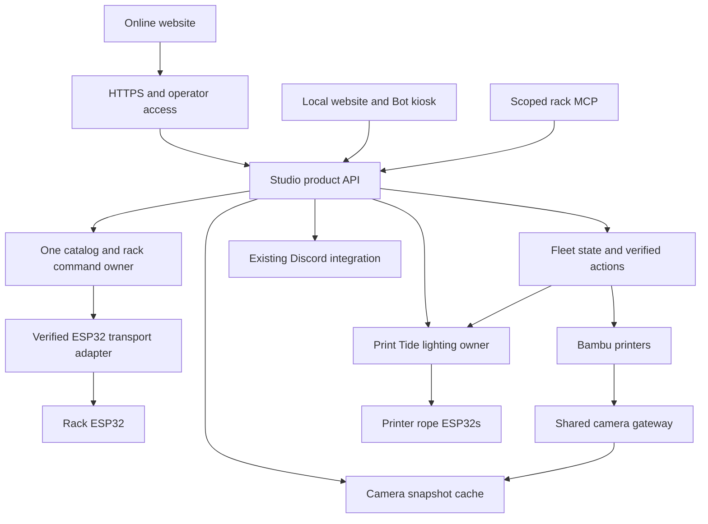

# Internet handoff for the agent already on the studio Pi

This page is public and readable without GitHub authentication. It contains the handoff and complete product brief. The complete source repository is private; a verified checkout is already on your Pi, so you do not need GitHub authentication to start working.

## Start on the Pi

Work in `/home/edi/studio-control`.

```sh
cd /home/edi/studio-control
git rev-parse HEAD
python3 scripts/verify_snapshot.py
```

Baseline commit: `01ce36e9ee9e1edcf0f00f056f7754e6aa648440`. Integrity verification reports 576 files if the checkout is unchanged. Compare later development changes against this baseline; do not overwrite them.

Read `AGENTS.md`, `HANDOFF.md`, `SETUP.md`, `docs/product-brief.md`, then the instructions for each component you touch.

All Mac Bot source has already been transferred to this checkout. No Mac access or Mac file links are needed. Private upstream: https://github.com/adiind/studio-control. Fetching/pushing requires your normal authorized GitHub credentials; local development can begin now.

## What you are taking over

The user wants one finished studio product, securely available online, with core rack, lighting and supported printer operations continuing locally during internet outages.

- **Rack / Bot:** preserve the face-first Bot, Talk, Find, Manage, photos, labels and physical Locate. One catalog/map supplies Bot and MCP. Direct ESP32 integration is desirable where installed firmware supports it.
- **Printers / Lights:** seven printer bays, actual status, timestamped cameras, existing lighting behavior and supported pause/resume/cancel in one interface.
- **Reliability:** reproducible releases, pinned dependencies, bounded connections/retries, graceful shutdown and observable recovery. Repeated printer restarts must not be the operating procedure.
- **Selected scope:** monitoring, cameras, lights, pause/resume/cancel. Upload/start jobs, slicing and queues are outside the selected scope.

## Complete source map

Under `/home/edi/studio-control/components/`:

| Component | Use |
| --- | --- |
| `bot` | Complete face-first Bot from the Mac: UI, server, shared packages, tests, labels, voice and bridge. Includes separate `public-demo` sample reference. |
| `mechatronics-rack-ui` | Rack catalog, geometry, coordinator, API and UI. |
| `printer-light-studio` | Existing live Print Tide renderer/UI and controller firmware source. |
| `printer-discord-dashboard` | Current dashboard, camera/media workers and Discord integration; includes October 3 FTPS repair. |
| `printer-led-mcp` | Persistent printer telemetry and lighting MCP host. |
| `rack-mcp` | Existing rack tools and CSV. |
| `ledwall-mcp` | Node 1 MQTT/MCP/button adapters. |
| `printer-discord-media-work` | Older undeployed Print Bay preview, reference only. |

`reference/` contains non-secret catalog/geometry/light-layout snapshots and service definitions. `handoff/` records hashes, original Git revisions and dirty working files. The duplicate rack `print-tide` copy was omitted; the observed live lighting source is `printer-light-studio`.

## Defects and limits to carry forward

- Find has a Pi path; Talk uses a different library/locate adapter. Setup, rack JSON and rack MCP CSV need one authority.
- Existing printer MCP has no pause/resume/cancel tools. Verify model/firmware capabilities and implement supported actions with request tracking and observed-state confirmation.
- Previous camera investigation reported one fresh RTSP camera and six unavailable printers with full FTP slots and no RTSP listener. Recheck current facts. Do not claim a new image from an unavailable source or present stale captures as live.
- Preserve the latest FTP repair: download in-session, release before encode/build, the two session-release regression tests and 180-second dashboard stop-timeout reference. This reduces long session holds; sudden power loss during a transfer remains unproven.
- The earlier diagnosis that manual context-manager cleanup was missing was retracted. Do not repeat it.
- The rack endpoint previously reported offline. Installed Node 1 identity/geometry remains unresolved; historical counts of 24/42/100 conflict. Prepared direct HTTP firmware is not proof of installed compatibility.
- Production entrypoints retain original absolute imports/paths. Port deliberately and preserve one command owner per hardware target.

## First executable work

Verify the snapshot. Establish an isolated offline baseline using the exact commands in `SETUP.md` and record fresh results. Reconcile the brief with actual source and existing changes, create an implementation sequence, then proceed with the first verified integration prerequisite. Continue the existing engines and visual language. Deliver working code and an inspectable result, not only another architecture proposal.

Packaging ran no application tests or live device operations. The earlier Pi agent reported 238 dashboard tests passing after the FTP repair; that is prior evidence, not a fresh baseline.

Original live deployments remain the rollback baseline. This handoff did not restart services, flash devices, issue printer commands or publish Discord changes. Live actions follow the user's current task authorization and applicable project instructions.

---

## Full product brief

The complete discovery brief follows. Host-specific private addresses are replaced with labels. Confirmed requirements and proposed design/acceptance targets are distinguished; resolve actual device capability before promising it.

# Studio system: problems, resources and proposed product direction

Date: 2026-10-03, America/Chicago. Status: discovery brief and proposed direction for review; not an approved implementation spec or deployment receipt.

## Product outcome

Build one coherent studio product that connects the component rack, the existing face-first Bot, seven printers and their lights. People should be able to find a component, understand it, locate its real bin, see what the printers are doing, view current camera images, manage lighting, and pause/resume/cancel supported printer jobs from a consistent interface.

The core runs in the studio and is available through a secure online website. Local inventory search, rack locating, lighting and supported printer controls continue when external internet access is unavailable. Online access requires the studio gateway and its internet connection. Cloud voice, remote users and Discord remain dependent on their respective external services.

Quality means reliable behavior, clear feedback, accurate physical mapping, accessible desktop/phone interfaces, automatic recovery and a reproducible release. It is not measured by the number of frameworks, MCP servers or UI pages.

## Confirmed user requirements

- Rack integration is a core requirement: MCP access and a direct integration with the existing Bot project.
- Direct ESP32 control is desirable, subject to the actual installed firmware and network contract.
- Printer and lighting control belong in one product interface.
- Printer scope: monitoring, cameras, lighting, pause, resume and cancel. Job uploads, starting new prints, slicing and queues are outside the chosen scope.
- The system must support studio operation and secure remote access; the user wants all product areas available online.
- Routine operation must not require monthly application upgrades, manual service recovery or repeated printer restarts.
- Preserve the existing Bot face and interaction language, real inventories, names, maps and the established lighting behavior.

## The problems to solve

| ID | Problem statement | Evidence and current resources | Required outcome |
| --- | --- | --- | --- |
| R1 | A visitor cannot depend on Bot conversation, Find, Manage and an external assistant agreeing about the same physical component and bin. | Bot Find uses the Pi rack API; Talk uses a separate local library and locate adapter; Setup maintains another draft. Rack MCP reads its own CSV. | One authoritative catalog and mapping, with stable IDs and revisions, supplies all four experiences. |
| R2 | Locating a part depends on the client and route used, making behavior and recovery inconsistent. | Bot Find goes through the Pi rack coordinator; rack MCP imports the LED-wall MCP and publishes directly. Its current function clears then sends individual pixel commands, separate from coordinator TTL handling. | Every authorized locate uses the same resolver and command owner, returns an actual acknowledgement outcome, and has a controller-enforced expiry. |
| P1 | An operator must assemble printer status, camera views and lighting behavior from separate applications. | Printer dashboard on 8773 and Print Tide on 8772 are separate live services. | One fleet view pairs each verified printer identity with its state, camera, rope status and contextual controls. |
| P2 | Camera failures have turned routine operation into manual maintenance. | The documented FTP repair moved encoding outside the FTP session. Existing camera blockage still requires recovery before live acceptance. | Shared native camera acquisition, bounded reconnects, accurate freshness and independent recording downloads; no routine FTP dependency for current camera images. |
| P3 | The requested printer controls are not a verified product capability. | Installed printer-led MCP exposes status and light tools, but no pause/resume/cancel tools. | Validate operations against actual printer models and firmware; perform an authorized command once and confirm the resulting printer state. |
| O1 | Access depends on remembering ports, host addresses and which MCP is active. | Rack web API listens on all Pi interfaces; lighting and printer UIs listen on its Tailscale address; rack/LED-wall MCPs use SSH stdio while printer-led MCP uses HTTP. | One online entry point, a local entry point, stable product URLs and a clear scoped rack MCP connection. Users configure the product rather than its internal service topology. |
| O2 | Working code and running processes have been treated as completion evidence, while field recovery and installed hardware remain uncertain. | Rack API reports its endpoint offline during this audit. Model-to-alias mapping and direct ESP32 firmware compatibility remain unverified. | A visible device/capability registry, installed-release receipt, end-to-end acceptance and sustained operation with realistic interruptions. |

## Resources verified during this session

These are live reads and local source inspection, not physical observations. No printer command, light command, firmware write, service restart or network change was performed for this brief.

| Resource | Verified state or interface | Reuse decision |
| --- | --- | --- |
| Studio gateway | Raspberry Pi 5 Model B, about 4 GB RAM; existing user services and Mosquitto listener. Roughly 1.3 GB memory available at inspection. | Use the existing gateway. Benchmark the complete camera workload before adding continuous transcoding or another heavy platform. |
| Bot workspace | `components/bot`; Hono/TypeScript backend, kiosk UI, face, voice, Find, Manage, labels, Handoff, controller setup. | Preserve the established product experience. Replace split catalog/locate dependencies behind stable interfaces. |
| Rack service | `original Pi deployment: mechatronics-rack-ui`; active service, port 8770. API returns 37 parts and a 7 × 6 rack. Endpoint availability reported `offline` at 15:07 CDT. | Candidate authority for the current live rack data. Reconcile metadata and physical mapping before migration. |
| Rack MCP | `original Pi deployment: rack-mcp/server.py`; CSV inventory and direct imported LED-wall MQTT transport. | Convert into a thin client of the authoritative rack operations; retain compatible tool names where practical. |
| Rack inventory comparison | CSV and web API both have 37 entries; IDs and LED mappings matched in this read. | Existing data can be preserved. Matching today does not provide ongoing synchronization. |
| Lighting engine | `original Pi deployment: printer-light-studio`, imported into `printer-led-mcp.service`; UI on 8772. | Reuse Print Tide's pure renderer, mapping schema, physical zones and single-writer transport. |
| Printer status/MCP | `original Pi deployment: printer-led-mcp`; active persistent service, HTTP MCP on 8765. Tools cover status and WLED/light behavior. | Reuse the status adapter and verified controller contracts. Do not treat these tools as a completed printer-action interface. |
| Printer UI and media | `original Pi deployment: printer-discord-dashboard`; dashboard, web, media and Discord bot services active. UI on 8773. | Reuse useful collection, freshness, media and notification logic behind the product API. The FTP lifecycle repair is part of the starting baseline. |
| Firmware resources | Existing MQTT ESPHome controllers; Bot also has prepared authenticated `/rack/info` and `/rack/command` firmware with request IDs and local expiry. | Verify the installed Node 1 contract before selecting or deploying a direct adapter. Prepared source does not prove installed compatibility. |
| Fleet description | Runtime README describes five X2Ds, one H2D and one X1C. | Treat as a documented fleet description. Verify alias, serial, model and firmware individually before choosing transports or exposing controls. |

### Source locations for the important findings

- Bot catalog/voice wiring: `components/bot/server/src/index.ts` and `server/src/routes/local.ts`.
- Bot Pi integration: `components/bot/server/src/rack/pi.ts`.
- Bot direct-controller bridge: `components/bot/server/src/setup/bridge.ts`, `scripts/node01-bridge.py`, `firmware/node01/components/rack_setup/rack_setup.h`.
- Live rack MCP: `original Pi deployment: rack-mcp/server.py`, including `_rows` and `rack_light_parts`.
- Live lighting contract: `original Pi deployment: printer-light-studio/AGENTS.md`, `DESIGN.md` and `light_studio/web.py`.
- Live printer interfaces: tool definitions in `original Pi deployment: printer-led-mcp/server.py` and the fleet endpoint in `original Pi deployment: printer-discord-dashboard/dashboard/web.py`.
- FTP repair: live dashboard `AGENTS.md` and the user-supplied repair accounting; this session confirmed the installed record but did not rerun the repair's tests or claim a new capture result.

Some READMEs retain historical milestone text that conflicts with newer service state. Installed capabilities, source and fresh snapshots take precedence over those historical paragraphs.

## Three architecture approaches

| Approach | Benefit | Tradeoff | Assessment |
| --- | --- | --- | --- |
| A. Local product API and shared UI over existing domain engines | Preserves tested lighting and data, keeps local operation, gives Bot/MCP/website one contract, and isolates camera failures. | Requires deliberate integration and contract testing; independent service lifecycles still exist internally. | Recommended. |
| B. Home Assistant foundation with a custom product UI | Existing Bambu and ESPHome integrations, device state and automation ecosystem. | Adds another platform and release surface; existing Print Tide and Bot behaviors still need integration. | Useful alternative if device automation becomes the primary product. Evaluate on a separate pilot rather than replacing the live system wholesale. |
| C. Cloud-first backend with direct ESP32 cloud connections | Hosted UI/API and shared online access without a studio rack backend. | Requires controller/network changes; printer camera and LAN control still need a local gateway. Internet outages affect physical workflows. | Poor fit for the selected local-operation requirement. |

## Recommended system boundaries

Create one product API with focused Rack, Fleet, Lighting and System operations. Internal adapters may remain Python or TypeScript; users and clients should not depend on that choice. Start by wrapping and converging existing engines, and replace a component only where its contract cannot meet acceptance requirements.



### What direct ESP32 should mean

Bot's server should call the rack operation directly through the shared product contract. The rack operation then talks to the ESP32 through one supported adapter. External assistants use MCP to call the same operation. MCP does not need to be an extra hop inside Bot's deterministic Locate path.

Initially preserve the working MQTT contract where it matches installed firmware. A direct authenticated HTTP or ESPHome native API adapter is a separate, reversible firmware/controller decision. The existing local HTTP firmware is a useful candidate, but its presence in source is insufficient evidence to replace the live Node 1 path.

Direct controller access does not remove the need for a host that owns inventory, user access, the website and remote commands. It can remove an intermediate service or broker from the rack path. The gateway remains useful for printers and cameras.

### Cameras and recorded media

Pilot go2rtc as the camera gateway. Configure one appropriate native source per verified printer; consumers use the gateway or cached snapshots. Frigate documents this one-camera-connection pattern in its [restream guide](https://docs.frigate.video/configuration/restream/). [go2rtc](https://github.com/AlexxIT/go2rtc) supplies streaming and snapshot interfaces and Linux ARM builds.

Camera transport must be selected from device capability, not a universal port guess. [OpenBambuAPI](https://github.com/Doridian/OpenBambuAPI/blob/main/video.md) documents RTSPS for X1/H2-family cameras and the separate P1/A1 camera protocol. Verify the actual fleet's model and reported camera endpoint.

Keep recording downloads and encoding in a low-priority worker. Release printer sessions before encoding; bound transfers and shutdown; limit disk retention; report capture and download health separately. Existing wedged FTP sessions are a recovery prerequisite, not proof that the lifecycle repair failed or that a new gateway can clear printer state.

### Local and online access

Serve a single product website locally and publish it through an authenticated outbound tunnel. [Cloudflare Tunnel](https://developers.cloudflare.com/cloudflare-one/networks/connectors/cloudflare-tunnel/) is a candidate for the public HTTPS route; [Access](https://developers.cloudflare.com/cloudflare-one/access-controls/applications/http-apps/self-hosted-public-app/) supplies identity gating. Existing Tailscale remains useful for administration.

Local operator access must have a functioning local session/authentication path when internet is unavailable. Browser clients receive neither printer credentials nor broker/firmware secrets. Public pages, if desired later, can have an explicitly restricted viewing role.

Cloud-hosted static assets alone do not make the printers online. The studio gateway, its outbound connection and the selected hardware adapters provide actual reachability. Remote control is unavailable while the studio is unreachable and must be shown honestly.

### MCP

Provide a scoped rack endpoint with search, details, snapshot, locate and clear. Route it through the same authorization, catalog revision and command logic as Bot. Preserve session compatibility during migration rather than terminating existing SSH clients.

Streamable HTTP is a standard transport with one MCP endpoint; implementation should follow the [MCP transport specification](https://modelcontextprotocol.io/specification/2025-11-25/basic/transports). Tool count and process count are separate from product capability. Raw LED commands and firmware operations should not become ordinary inventory tools.

## User-facing product

Two primary work areas share identity, device state, navigation and a visual system:

- **Rack / Bot:** retain the face-first conversation, photo bubbles, Find, part detail, Locate, labels and Handoff. Talk and Find use the same real catalog and selections. Missing photos or knowledge remain explicit; stock is never inferred from component descriptions.
- **Printers / Lights:** show the seven bays in verified physical order. A printer card combines current state, camera age, progress, job, time remaining, temperatures, rope status and permitted pause/resume/cancel actions. Lighting detail contains the existing map, direction, accent, brightness and preview controls. Advanced configuration opens progressively rather than crowding the fleet overview.

Shared management provides catalog editing, mapping confirmation, change history, backup/restore and connection setup. System diagnostics are accessible when needed and do not dominate normal workflows.

Commands visibly move through requested, accepted, confirmed or unknown/failed states. A transport acknowledgement is distinguished from observed printer state and physically confirmed rack mapping. Unsupported actions explain the capability gap; a stale printer state does not enable a destructive action.

## Reliability and maintenance requirements

1. One owner publishes commands to each hardware channel. Competing rack MCP/button/UI writers require explicit arbitration; a second renderer must not be introduced for the same printer ropes.
2. Request IDs prevent duplicate operations. Ambiguous printer-action results are reconciled from state before any retry. Reconnecting never replays a stale cancellation, starts a job or celebrates historical FINISH state.
3. Hardware identities, printer aliases and physical bay order are distinct. Hostnames/IPs may change without changing user-facing identity.
4. Rack expiry belongs on the controller for crash-safe behavior. Confirm this against installed firmware before claiming it.
5. Queues, retries and shutdown have bounded deadlines. Heavy encoding holds no printer network session. A health guard cannot kill an active transfer merely because a different worker stalled.
6. An unavailable printer, camera or LED node degrades only its relevant feature. Manual rack search and UI navigation work without AI or camera services.
7. Pin application dependencies and installed artifacts. Upgrades are staged for a concrete feature, compatibility need or security fix, with a tested rollback and data migration backup.
8. Logs, media and history have retention budgets. Storage exhaustion is detected before it disables catalog saves or command bookkeeping.
9. A release records source revision/hash, application versions, schema versions, enabled adapters and device firmware inventory. One documented install/restore procedure recreates the supported deployment without a development Mac.
10. Preserve independent restart boundaries for camera/media, product API and lighting so a presentation or recording change does not require restarting the live light renderer.

## Release acceptance

These are proposed targets, to be measured on the actual gateway before the approved implementation spec freezes them.

| Scenario | Required evidence |
| --- | --- |
| One rack truth | A Manage change becomes visible in Talk, Find and MCP through the same catalog revision; no independent writable CSV copy remains. |
| Physical Locate | Every mapped bin has an operator-confirmed LED assignment; invalid/unmapped IDs are refused; the device acknowledges requests and locally expires highlights. |
| Online and local | Phone and desktop complete rack and fleet workflows through HTTPS remotely and the local route; loss of external internet preserves local core workflows. |
| Camera acquisition | Every camera-enabled supported printer returns real timestamped captures at the accepted cadence. Stationary scenes are not classified as frozen solely from identical pixels. |
| Shared camera connection | Concurrent website, Discord and assistant viewing does not add direct printer camera sessions. Gateway packet/frame timestamps establish that the cached image is current. |
| Printer actions | Per verified model/firmware, an authorized pause, resume and cancel is issued once, followed by observed state confirmation. Uncertain acknowledgements do not cause blind retries. |
| Lighting behavior | The shared renderer matches existing foot/active/cap zones; reconnects and restarts do not replay old completion celebrations; preview is isolated from hardware. |
| Recovery | Recover after network loss and controlled restart. Provisional goal: reconnect within 60 seconds after a reachable device returns; document hardware limitations explicitly. |
| Endurance | Seven days with all configured printers/controllers, realistic print/media workload and concurrent clients; no unattended slot accumulation, unbounded resource growth or recurring manual recovery. A longer 30-day field run follows the first release. |
| Usability | Keyboard access, readable focus, contrast, reduced motion, phone layouts, progress feedback, preservation of drafts and accurate offline/error states; browser observation accompanies functional verification. |
| Restore and rollback | Restore data and software on a clean supported host or disposable equivalent; roll back a staged upgrade without losing catalog/map/history or replaying hardware operations. |

## Delivery order

1. **Catalog and device baseline:** reconcile authoritative data and enrich Bot records; identify every controller/printer; record firmware/capabilities, owners and the rack-offline reason using read-only diagnostics.
2. **Rack/Bot contract:** unify Talk, Find, Manage and MCP behind the rack authority. Select and validate the existing transport first; design direct ESP32 migration only where it improves the measured behavior.
3. **Fleet/camera reliability:** pilot shared native camera acquisition, isolate recordings, carry forward the FTP repair and measure resource use before enabling the whole fleet.
4. **Printers/Lights interface:** integrate existing fleet and Print Tide views; implement verified pause/resume/cancel and the required command audit/reconciliation behavior.
5. **Online release and endurance:** local authentication, remote HTTPS, reproducible installation, restore/rollback and field acceptance.

Each delivery needs its own focused approved design, implementation plan and acceptance evidence. These are integration milestones for one product, not separate user-facing products.

## Decisions still requiring evidence

- Installed Node 1 identity/firmware and why the rack API currently reports it offline.
- Alias-to-model/firmware mapping, LAN camera enablement and supported control authorization for each printer.
- Which existing writer owns each lighting target, including the physical button and direct MCP paths.
- Remote hostname, identity provider and the local operator-login arrangement.
- Camera workload and practical freshness cadence within Pi memory/CPU/network limits.

The product direction can be reviewed now. These evidence gaps must be resolved before promising device capability or scheduling a hardware migration.
